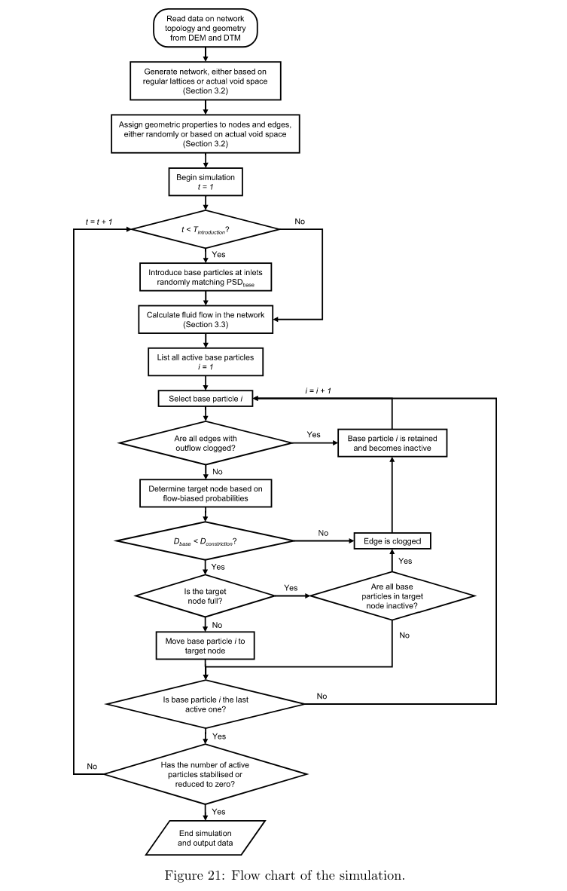
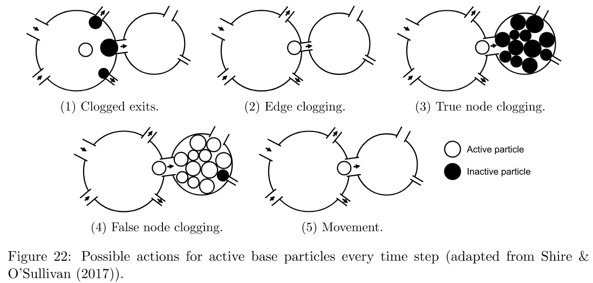

# Simulating Filtration Processes using a Network Model

My final year project in Civil Engineering at Imperial College London (2019). It is a pore-scale network model, written in object-oriented MATLAB, that simulates how granular filters in embankment dams and dewatering wells retain or lose the base soil behind them.

📄 [Thesis](docs/thesis.pdf) · 🖼️ [Poster](docs/poster.pdf)

## Why

Piping (internal erosion through an ineffective filter) causes about half of embankment dam failures. Filter design rules such as Terzaghi's are empirical. Particle-based methods (coupled DEM-CFD) give the most complete picture, but they are too expensive to simulate many particles at once. A network model is much cheaper: it represents the void space as pores (nodes) joined by constrictions (edges) and moves particles through it step by step.

Earlier network models used regular lattices with randomly assigned pore and constriction sizes. This model adds two features:

1. **Accurate void space structure:** the network is built from DEM-generated filter samples using the Delaunay Triangulation Method (DTM). It keeps the real topology and the spatial correlation between pore and constriction sizes.
2. **Realistic fluid flow:** the model solves Stokes flow across the network, and each particle chooses its next edge with flow-biased probabilities.

## How it works

<p align="center"></p>

At each time step, the model introduces base particles at the inlets to match a particle size distribution (PSD) and recalculates the fluid flow. Each active particle then moves, gets strained at a constriction, or is retained because its exits or its target pore are clogged:

<p align="center"></p>

What I implemented:

- Network generation from DEM/DTM data and from regular lattices (square, cubic, BCC, FCC), with geometry assigned from the real void space or at random
- The constriction size of each edge, and the ratio of reduced to total area at each constriction
- A sparse-matrix flow solver, checked against OpenPNM
- Particle transport with edge clogging, node clogging and several transport rules (flow-biased, area-biased, random)
- Percolation thresholds, shortest erodible paths, two-point spatial correlation, and analytical constriction size distributions
- Batch runs with results saved and reloaded for analysis, and a validation suite

## Findings

- Filter effectiveness is fully explained by the **percolation threshold** (about 58%, or 65% with premature node clogging) together with node clogging. Both depend on the network, so regular lattices with randomised geometry are not physically justified.
- The diameters of the largest erodible particles agree closely with geometric DEM simulations (Roozbahani et al. 2014), but only qualitatively with filter experiments (Kenney et al. 1985).
- Larger particles follow fewer common erodible paths, and the paths become more tortuous as particle size and time increase. In ineffective filters, these paths stay similar from run to run.
- In 504 filter-base combinations:
  - d85B(SA) (Indraratna et al. 2007) best separates "seal, no erosion" from "seal, some erosion".
  - d95B (Foster & Fell 2001) best separates "seal" from "no seal, continuous erosion".
  - The constriction size D35c explains the results better than D15F.

## Code

| Folder | Contents |
|---|---|
| [`src/`](src) | `Simulator`: top level (options, time stepping, flow solver). `Filter`: builds the network and analyses it (percolation, constriction sizes, spatial correlation). `Base`: base soil PSDs. `Statistics`: results and post-processing. Also `Validate`, `Plot`, `Constants` and `FileLocation`. `stokes_flow.py` is the optional OpenPNM flow solver |
| [`analysis/`](analysis) | `runner*` scripts run batches of simulations; `analysis*` and `report*` scripts produce the thesis figures |
| [`test/`](test) | `examples.m` walks through the main methods; `validationAllTests.m` runs the validation suite (connectivity, mass conservation, comparison with OpenPNM) |

The code is MATLAB. The optional Python flow solver uses OpenPNM 1.x.

### Running it

The input data (DEM filter samples and their DTM output) are not included in this repo. The code expects them in `data/` at the repo root (see `FileLocation.m`). With the data in place, run scripts from their own folder, since they add `../src` to the path:

```matlab
cd test
simulator = Simulator('transportLogicType', 'flowbiased');
simulator = simulator.createFilter(1.2);              % filter Cu = 1.2, dense
simulator = simulator.createBase(0.3, 'run', 1);      % base d50 = 0.3
simulator = simulator.simulateFiltration('run', 1, 'followingRun', 1);
```

## Acknowledgements

Supervised by Prof. Catherine O'Sullivan and Prof. Adnan Sufian, Department of Civil and Environmental Engineering, Imperial College London. Special thanks to Prof. Sufian for applying the DTM to the filter samples.
